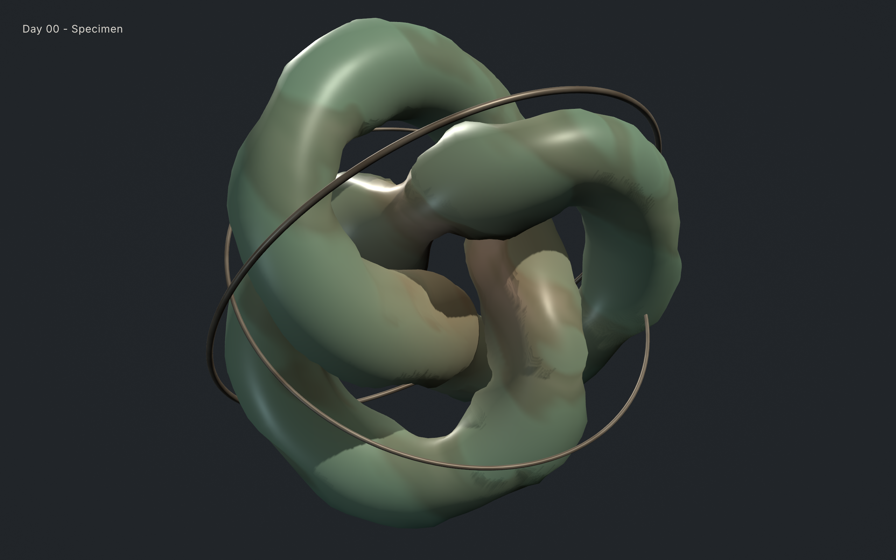
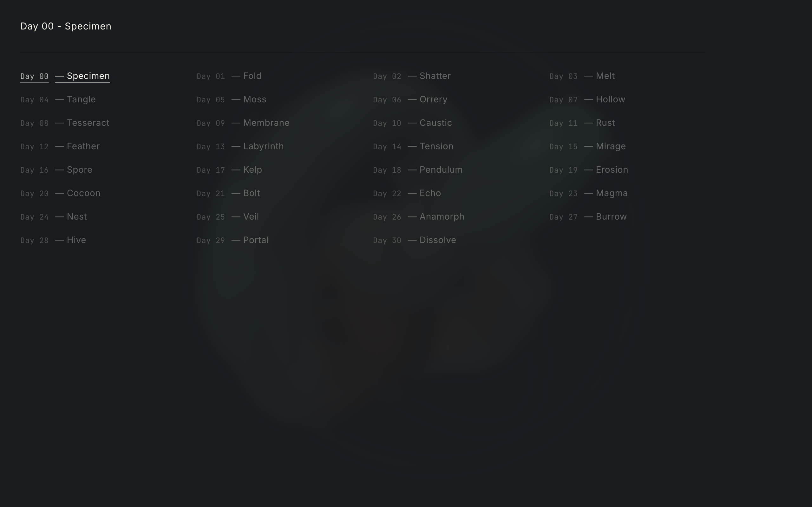

# Codevember 2026



30 days of interactive WebGPU, Three.js `r187` (`WebGPURenderer` + `TSL`), Rapier `0.21`, and raw WGSL specimens—staged on a unified **Chalky Slate (`#212529`)** studio ground with **Physical Mineral & Botanical Pigments** (`Kubelka-Munk` 2-flux glazes and `Beer-Lambert` transmittance).



## Quick Start

Requires Node.js `24.21+` and a WebGPU-enabled browser.

```bash
git clone https://github.com/andrewvoirol/code-vemeber-26.git
cd code-vemeber-26
npm install
npm run dev
```

## How It Works

Move, press, hold, or flick the pointer across the suspended specimen to inject physical momentum, shear, heat, or optical refraction directly into the medium. Click the top-left `"Day XX - [THEME]"` header (or press `←` / `→`) to jump between completed days via the 30-day index drawer.

Under the hood, each day compiles as an isolated Multi-Page App (MPA) route (`/01-fold/` through `/30-dissolve/`) so every piece gets a fresh DOM document and WebGPU `GPUDevice` with zero cross-day VRAM leaks, while `/` automatically boots the latest completed specimen. All 30 days share [`SpecimenStage.ts`](src/core/stage/SpecimenStage.ts) (3-point studio softbox + calcite rim lighting rig), [`PointerField.ts`](src/core/stage/PointerField.ts) (coalesced EMA pointer velocity, dwell, and impulse tracking), and [`palette.ts`](src/core/palette.ts) (14 natural mineral and botanical pigments).

### Daily Workflow Commands

```bash
# Scaffold Day XX (tsl | tsl-compute | rapier | wgsl)
npm run day:new 01

# Static WGSL AST & struct layout check (wgsl_reflect)
npm run lint:wgsl

# Hardware Metal Chromium verification + 3-panel Contact Sheet
npm run bench:optical -- --day 00
```

## Tech Stack

| Layer | Technology |
| :--- | :--- |
| **Rendering** | WebGPU, Three.js `0.187.0` (`three/webgpu` + `three/tsl`), Raw WGSL |
| **Physics & Optics** | `@dimforge/rapier3d-compat` `0.21.0`, Kubelka-Munk 2-Flux, Beer-Lambert |
| **Build & Routing** | Vite `8.3.5` (Rolldown MPA), Vercel Clean URLs |
| **Language & Types** | TypeScript `7.0.2`, `@webgpu/types` `0.1.74` |
| **Verification** | Vitest `5.0.5`, `wgsl_reflect` `1.6.0`, Playwright Metal (`--use-angle=metal`) |
